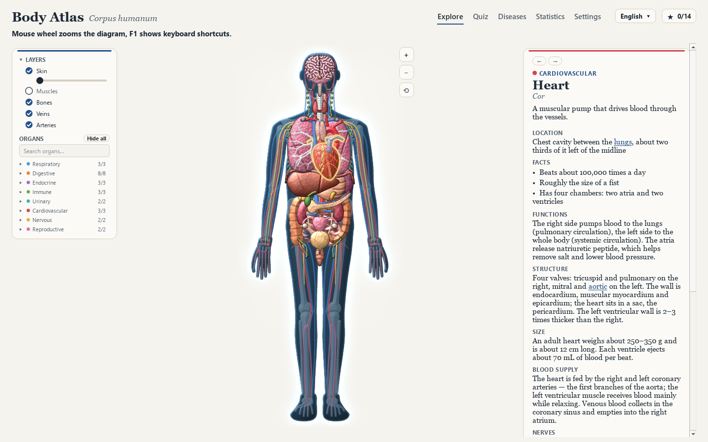
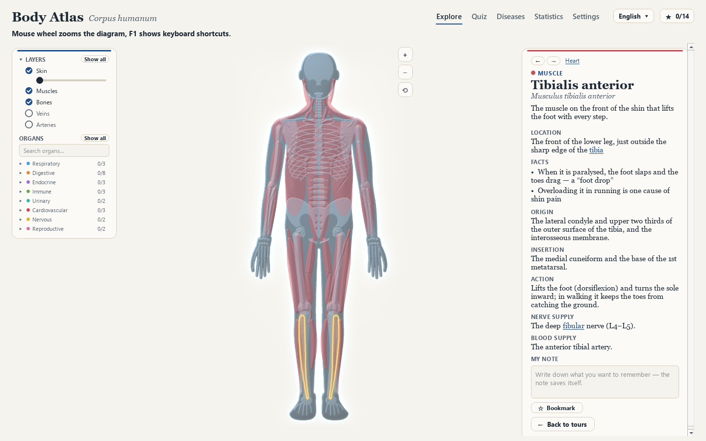
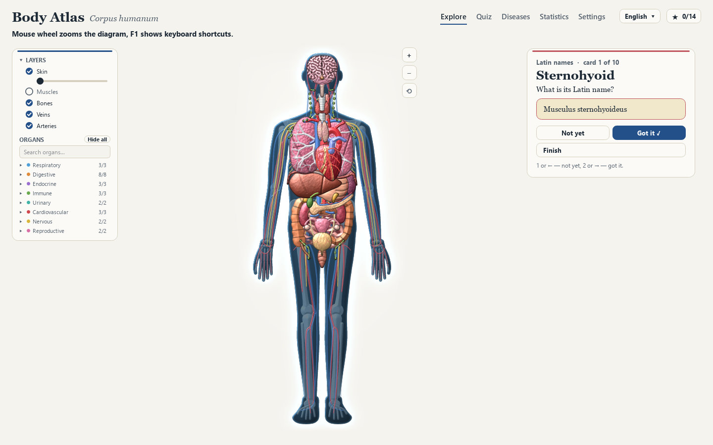
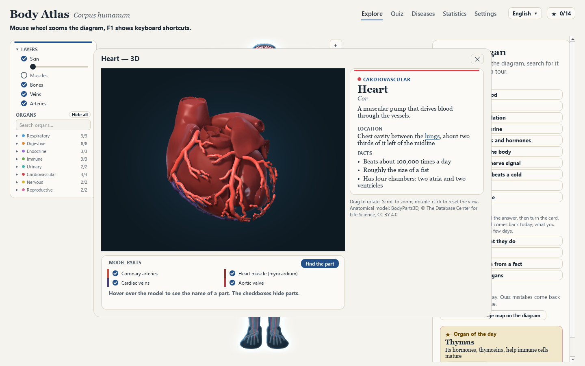
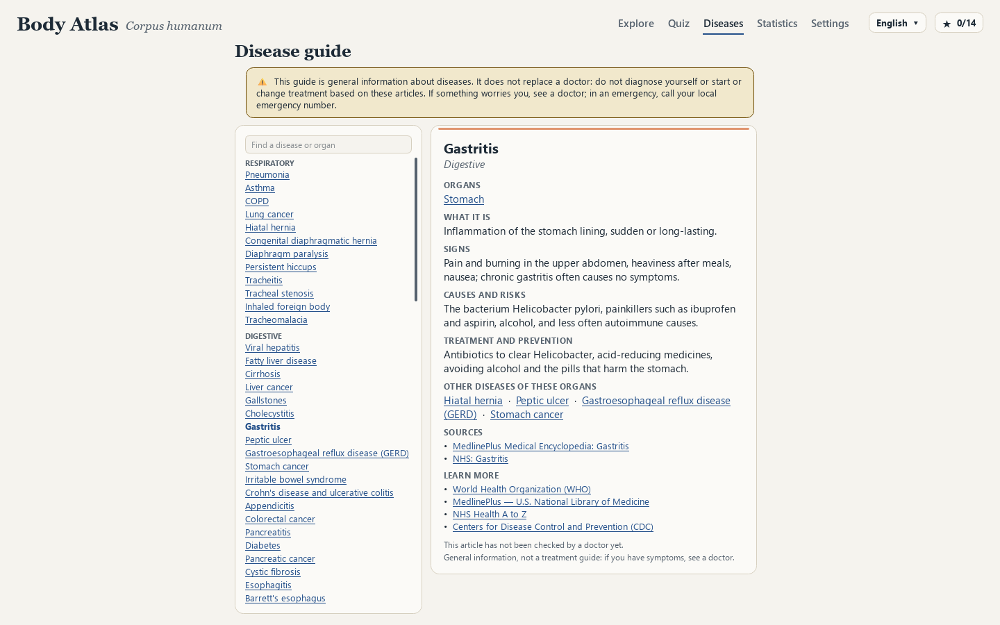

# Organism 360

**[Русская версия](README.md)** · **[Download](https://github.com/mattherkus/igra/releases/latest)**

An interactive atlas of the human body for learning anatomy: a full-height body map you can hover and click,
cards for 27 organs and 42 bones and muscles, guided tours, flashcards, nine kinds of quiz, a reference of
96 diseases with sources, statistics with a knowledge map, and 3D anatomical models of every organ.
The interface is in English and Russian, with Latin names for every organ, bone and muscle.



## What's inside

- **Body map.** A full-height figure with skin, muscles, bones, veins, arteries and 27 organs. Hover to
  highlight, click to open a card; zoom with the mouse wheel. The *Layers* panel hides the skin, bones, vessels or
  any organ, and the search box finds an organ by name in any language. The heart beats and the lungs breathe.
- **Cards.** What an organ does, where it lies, its structure, size, blood and nerve supply, facts and
  diseases; bones and muscles have their own cards (origin, insertion, action, innervation). Mentions of other
  organs and diseases are links. Icons next to the title open the 3D view, bookmark the card and read it
  aloud; below the card is a place for **your own note**.
- **Tours** — step-by-step stories along a route: the path of food, of air, of blood and of urine, the nerve
  signal from a finger to the brain, how the body beats a cold, blood sugar, the path of bile and more.
- **Flashcards** — four decks (organs, Latin names, facts, diseases) with spaced repetition: what you couldn't
  recall comes back the same day, what you recalled comes back in a few days.
- **Quiz** — find the organ, name it, guess it from a fact or from a rotating 3D model, bones and muscles,
  put a route in order, a mixed game, a timed exam with a grade, and a daily challenge. Questions can be
  limited to one body system, to the mistakes of the last game, to cards that are due, or to your bookmarks.
  A question you don't know can be skipped (it counts as a mistake and shows the right organ).
- **Diseases** — a reference of 96 diseases linked to the organs, each with its sources (MedlinePlus, NHS,
  WHO fact sheets and others). It is not a substitute for a doctor, and the page says so.
- **Statistics** — accuracy by quiz type and by body system, the last 30 games, weak spots to train, and a
  knowledge map that colours the organs by how well you know them. Your progress can be exported to a file,
  imported on another computer or reset (the previous data is kept in `progress.json.bak`).
- **3D** — anatomical meshes from open atlases (BodyParts3D, Human Reference Atlas, Open Anatomy, Z-Anatomy),
  rendered on the GPU with OpenGL 3.3 (with a NumPy fallback). Parts of a model can be hidden or named under
  the cursor, and *Find the part* is a mini-quiz inside the 3D view.
- **Comfort** — light (default), dark or *Match system* theme, interface scaling,
  keyboard control without a mouse, reading a card aloud, and a short tour of the window on the first launch.

| | |
|---|---|
|  |  |
|  |  |

## Download

Ready-made builds that do not need Python are on the
[Releases page](https://github.com/mattherkus/igra/releases/latest):

- **Windows** — `OrganismAtlas-Setup-<version>.exe`: open it, choose a folder and click *Install*. The first start
  may take a minute while Windows Defender scans the new files.
- **macOS** — `OrganismAtlas-<version>-macos.zip`: unzip and open `OrganismAtlas.app` (it is not signed: right-click
  → *Open* the first time).
- **Linux** — `OrganismAtlas-<version>-linux.tar.gz`: unpack and run `OrganismAtlas/OrganismAtlas`.

## Run from source

Python 3.10 or newer:

```bash
pip install -r requirements.txt
python run.py
```

Or install it as a package (`pip install -e .`) and run `organism-atlas`.

Tests (about two minutes; the window is created off-screen and GPU tests are skipped without OpenGL 3.3):

```bash
python -m unittest discover -s tests -t .
```

Style checks: `pip install ruff`, then `ruff check .`. GitHub Actions runs both ruff and the tests before every build.

Build a standalone program with PyInstaller (`pip install -r requirements-dev.txt`, then
`python tools/build_exe.py`), or the Windows installer with Inno Setup (`python tools/build_setup.py`); GitHub
Actions builds all three platforms and publishes a release for a `v*` tag.

Screenshots and the GIF for the project page (`docs/index.html`, published to GitHub Pages by a manual run of
the *Сайт* workflow) are made by `python tools/screenshots.py` (off-screen, in a
temporary folder, so your settings and progress are untouched).

## Where things live

- `organism_atlas/lang/en.json`, `ru.json`, `la.json` — **all texts**: organ, bone and muscle cards, tours,
  diseases with their sources, interface strings. Latin names are in `la.json`.
- `organism_atlas/questions/<organ>.json` — questions for *Guess by fact* (531 in total); check them with
  `python -m organism_atlas.questions`.
- `organism_atlas/organs/`, `organism_atlas/body/` — the drawing of each organ and of the body (NumPy + Pillow).
- `organism_atlas/render3d/` — the 3D renderer; `render3d/look.json` sets lights and materials.
- `organism_atlas/ui/` — the Qt interface (PySide6).
- `organism_atlas/models/mesh/ATTRIBUTION.md` — the sources and licences of the 3D models.

The detailed developer guide (where to change what, the file formats) is in the [Russian README](README.md).

## Anatomical models

The 3D meshes come from BodyParts3D (© The Database Center for Life Science, CC BY 4.0), the Human Reference
Atlas (HuBMAP, CC BY 4.0), the SPL Head and Neck Atlas (Open Anatomy, 3D Slicer License part B) and
Z-Anatomy (CC BY-SA 4.0). Each model shows its credit under the 3D view; see
[ATTRIBUTION.md](organism_atlas/models/mesh/ATTRIBUTION.md) for details.

## Medical disclaimer

The disease reference is educational. It does not replace a doctor, and its articles have not been reviewed
by a physician yet (each article shows whether it has).
